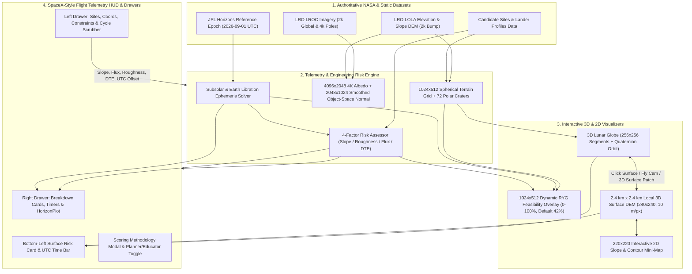
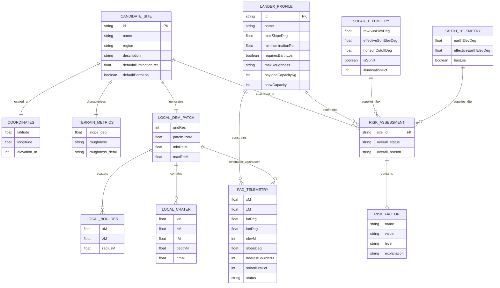
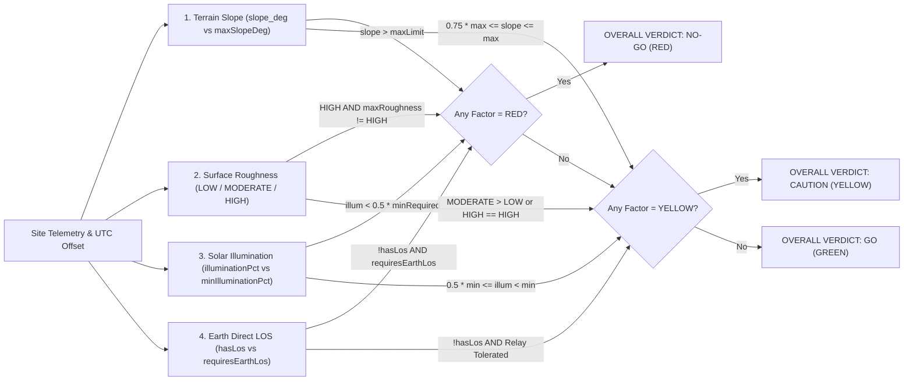
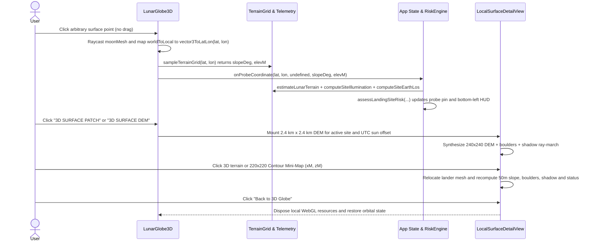

<div align="center">

# TO LAND OR NOT TO LAND

**Interactive Lunar Landing Site Risk Assessment, 3D Surface Telemetry & Touchdown Hazard Decision Support Platform**

*Built for NASA Space Apps Challenge 2026 — Open Science & Artemis Lunar South Pole Exploration*

[](./LICENSE)
[](https://to-land-or-not-to-land.vercel.app/)
[](https://www.spaceappschallenge.org/)
[](https://react.dev/)
[](https://www.typescriptlang.org/)
[](https://threejs.org/)
[](https://tailwindcss.com/)
[](./Dockerfile)

</div>

---

### 🌐 Live Interactive Mission Control
> **Experience the platform live in your browser:**  
> 🔗 **[https://to-land-or-not-to-land.vercel.app/](https://to-land-or-not-to-land.vercel.app/)**  
> *(Zero installation required — WebGL 3D lunar terrain, real NASA datasets, and real-time telemetry)*

---

## Table of Contents

1. [Mission Context & Executive Summary](#1-mission-context--executive-summary)
2. [Core Platform Capabilities](#2-core-platform-capabilities)
3. [System Architecture, ER Model & Engineering Diagrams](#3-system-architecture-er-model--engineering-diagrams)
4. [Curated Landing Sites & Lander Profiles](#4-curated-landing-sites--lander-profiles)
5. [Repository & File Structure](#5-repository--file-structure)
6. [Scientific & Mathematical Foundations](#6-scientific--mathematical-foundations)
7. [Quick Start & Local Deployment](#7-quick-start--local-deployment)
8. [NASA Data Sources & Attribution](#8-nasa-data-sources--attribution)
9. [Engineering Quality Protocol, Team & License](#9-engineering-quality-protocol-team--license)

---

## 1. Mission Context & Executive Summary

Landing near the **Lunar South Pole (`-70°` to `-90°` latitude)** presents an extraordinary engineering paradox. Peaks of near-eternal light (such as **Shackleton Crater Rim** and **Malapert Massif Peak**) receive quasi-continuous solar illumination ideal for photovoltaic power, while sitting just kilometers away from **Permanently Shadowed Regions (PSRs)** harboring cryogenic water-ice volatiles.

Because solar elevation hovers only **`+1°` to `+4°`** above the polar horizon, minor topographic ridges cast kilometer-long dynamic shadows, steep crater walls threaten lander tip-over, boulder aprons create touchdown hazards, and low southern Earth libration angles can sever **Direct-to-Earth (DTE)** telemetry links.

**To Land or Not to Land** bridges high-level orbital reconnaissance and meter-scale touchdown verification in a SpaceX Dragon/Starship-inspired monochrome telemetry interface:

- **Whole-Moon 3D WebGL Globe** built with `THREE.ObjectSpaceNormalMap`, isotropic polar LROC blending, and spherical LOLA elevation gradients so `-90°` renders seamlessly with zero polar distortion or starburst artifacts.
- **2.4 km × 2.4 km Local 3D Surface DEM Inspector (`10 m/px`)** capable of zooming down to meter-scale boulders, crater bowls, regolith micro-relief, and interactive touchdown pad relocation.
- **Live 4-Factor Flight Risk Engine & Synodic Cycle Ephemeris Simulator** that dynamically recalculates `GO` / `CAUTION` / `NO-GO` verdicts, shadows, and Earth LOS across arbitrary Moon coordinates and UTC mission timestamps.

---

## 2. Core Platform Capabilities

| Capability | Module | Engineering Highlights |
| :--- | :--- | :--- |
| **Whole-Moon 3D Globe** | `LunarGlobe3D.tsx` | `256 × 256` tessellation, native **4K (`4096 × 2048`)** LROC monochrome albedo (`maxAniso`), **`2048 × 1024`** Gaussian-deblocked `THREE.ObjectSpaceNormalMap` (zero polar TBN seams), `absLat > 84°` isotropic 4-tap LROC cap smoothing, and 27 IAU South Pole craters + 45 procedural micro-craters (`-68°` to `-78°` Hermite feathering). |
| **Quaternion Orbit Controls** | `LunarGlobe3D.tsx` | Gimbal-lock-free arcball/quaternion orbital rotation around `(0, 0, 0)` with inertial damping, fine low-orbit drag scaling (`MIN_CAM_DIST = 4.10`), and zero-React-rerender 60 FPS imperative DOM pin/leader-line projection. |
| **Dynamic RYG Overlay HUD** | `LunarGlobe3D.tsx` | Smooth `1024 × 512` translucent sphere layer driven by mission constraints and UTC ephemeris; toggleable **`Landing Assessment Overlay: ON / OFF`** and live **`Overlay Opacity (0–100%, default 42%)`** slider over unobstructed monochrome terrain. |
| **Click-to-Inspect & Custom Coords** | `LunarGlobe3D.tsx`, `App.tsx` | Single-click any location on the Moon to sample the LOLA grid, deploy a target probe pin, and inspect live `GO`/`CAUTION`/`NO-GO` telemetry in `[data-testid="surface-risk-hud"]`; or deploy exact targets via the `COORDS` popover. |
| **2.4 km 3D Local Surface DEM** | `LocalSurfaceDetailView.tsx` | Coordinate-seeded `240 × 240` (`10 m/px`) local lunar DEM patch with 3D `InstancedMesh` boulder clusters, ray-marched crater self-shadowing, **`Regolith` / `RYG Hazard` / `Topo Contours`** modes, **`Mesh`** wireframe, camera presets (`Oblique`, `Low Grazing`, `Overhead`), and clickable 3D / `220 × 220` 2D Mini-Map touchdown pad relocation. |
| **4-Factor Risk Engine** | `riskEngine.ts` | Evaluates **Terrain Slope**, **Surface Roughness**, **Solar Illumination**, and **Earth LOS (DTE)** against customizable vehicle limits with deterministic worst-case dominance (`RED > YELLOW > GREEN`). |
| **Synodic Cycle & UTC Simulator** | `lunarTelemetry.ts`, `App.tsx` | Scrub $\pm 14.77\text{ days}$ across the `29.530589`-day lunar synodic cycle or step UTC (`-1D`, `-6H`, `T0`, `+6H`, `+1D`, custom date/time) while synchronizing 3D directional lighting, horizon masks, DTE libration, and `CountdownTimers`. |
| **Flight Telemetry & Dual Modes** | `HorizonPlot.tsx`, `MethodologyModal.tsx`, `Glossary.tsx` | Slide-out left (`Mission Inputs`) & right (`Telemetry`) drawers, 2D Sun/Earth azimuth-elevation `HorizonPlot`, topographic `ElevationProfile`, `PlainEnglishSummary`, **`Planner` vs `Educator`** inline glossary tooltips, and Scoring Methodology modal. |

---

## 3. System Architecture, ER Model & Engineering Diagrams

### 3.1 System Architecture & Data Pipeline (`flowchart TD`)



---

### 3.2 Domain Entity-Relationship Diagram (`erDiagram`)



---

### 3.3 4-Factor Risk Assessment Decision Matrix (`flowchart LR`)



---

### 3.4 Click-to-Inspect & Local 3D Surface Workflow (`sequenceDiagram`)



---

## 4. Curated Landing Sites & Lander Profiles

### Benchmark Candidate Sites ([`candidateSites.ts`](./client/src/data/candidateSites.ts))

| Site Name | Region | Lat / Lon | Elevation | Slope | Roughness | Baseline Sun Flux | Earth DTE | Mission Significance |
| :--- | :--- | :---: | :---: | :---: | :---: | :---: | :---: | :--- |
| **Shackleton Crater Rim** | South Pole | `-89.54°`, `0.00°` | `+4,200 m` | `4.2°` | `LOW` | `86%` | Direct LOS | Priority Artemis III ridge adjacent to PSR water-ice cold traps. |
| **Connecting Ridge** | South Pole | `-89.45°`, `-137.30° (137.30°W)` | `+3,850 m` | `9.6°` | `MODERATE` | `64%` | Direct LOS | Elevated Artemis ridge corridor with narrow landing tolerances. |
| **Malapert Mountain Peak** | South Pole | `-84.90°`, `12.90°` | `+5,000 m` | `7.8°` | `MODERATE` | `78%` | Direct LOS | Prominent southern massif providing strong Earth relay geometry. |
| **Nobile Crater Region** | South Pole | `-85.20°`, `53.50°` | `-1,200 m` | `18.4°` | `HIGH` | `18%` | Occluded | Deep volatile-bearing depression with severe wall & shadow hazards. |
| **Mare Tranquillitatis (Apollo 11)** | Equatorial | `0.67°`, `23.47°` | `-20 m` | `1.8°` | `LOW` | `92%` | Direct LOS | Historical baseline basaltic plain with minimal terrain hazard. |

### Reference Spacecraft Constraint Profiles ([`landerProfiles.ts`](./client/src/data/landerProfiles.ts))

| Vehicle Profile | Agency / Era | Max Slope | Min Solar Flux | Max Roughness | Direct Earth DTE | Payload / Crew |
| :--- | :--- | :---: | :---: | :---: | :---: | :---: |
| **Mission Default Parameters** | Artemis Criteria | `10.0°` | `60%` | `MODERATE` | Required | `15,000 kg` / `4 crew` |
| **SpaceX Starship HLS** | NASA Artemis III/IV | `8.0°` | `65%` | `MODERATE` | Required | `100,000 kg` / `4 crew` |
| **Blue Origin Blue Moon MK2** | NASA Artemis V | `10.0°` | `60%` | `MODERATE` | Required | `30,000 kg` / `4 crew` |
| **CLPS / VIPER Scout** | NASA / CLPS Robotic | `15.0°` | `35%` | `HIGH` | Optional (Relay) | `450 kg` / Uncrewed |
| **Apollo Lunar Module** | Historical (1969–1972) | `6.0°` | `75%` | `LOW` | Required | `4,700 kg` / `2 crew` |

---

## 5. Repository & File Structure

```text
to-land-or-not-to-land-/
├── .github/
│   └── PULL_REQUEST_TEMPLATE.md      # NASA dataset attribution & verification PR checklist
├── docs/
│   ├── CESIUMJS_3D_GLOBE_SPEC.md     # Architectural spec for global-to-polar 3D visualization
│   ├── LAURI_TASK_PLAN.md            # Science & visualization milestone plan
│   ├── candidate_sites.md            # Terrain dossier on Artemis candidate landing zones
│   ├── data_sources.md               # NASA LRO LOLA, LROC & JPL Horizons provenance
│   └── risk_methodology.md           # Scoring formulas and G/Y/R flight threshold rationale
├── scripts/
│   ├── build-lunar-textures.ps1      # Helper script to generate/optimize static texture maps
│   └── README.md                     # Asset pipeline notes
├── client/                           # React + TypeScript + Vite WebGL application
│   ├── public/
│   │   └── textures/
│   │       ├── lroc_color_2k.jpg         # NASA LROC global monochrome/albedo equirectangular map
│   │       ├── lroc_color_poles_4k.jpg   # High-res LROC polar mosaic for surface synthesis
│   │       ├── lola_bump_2k.jpg          # NASA LRO LOLA global elevation heightmap
│   │       └── lola_slope_overlay_2k.png # Reference LOLA gradient map
│   ├── src/
│   │   ├── components/
│   │   │   ├── LunarGlobe3D.tsx          # Main 3D WebGL Moon, ObjectSpaceNormalMap & HUD
│   │   │   ├── LocalSurfaceDetailView.tsx# 2.4 km x 2.4 km 3D Local DEM, boulders & 2D contour map
│   │   │   ├── LandingParametersPanel.tsx# Mission constraints sliders, toggles & presets
│   │   │   ├── HorizonPlot.tsx           # 360 deg polar azimuth-elevation Sun/Earth sky plot
│   │   │   ├── ElevationProfile.tsx      # 1 km landing approach cross-section profile
│   │   │   ├── CountdownTimers.tsx       # Daylight remaining & DTE comms window countdowns
│   │   │   ├── ComparisonModal.tsx       # Multi-site side-by-side trade-study matrix
│   │   │   ├── MethodologyModal.tsx      # Green/Yellow/Red rubric & dataset documentation modal
│   │   │   ├── CustomProbeModal.tsx      # Coordinate targeting helper modal
│   │   │   ├── LanderSelector.tsx        # Spacecraft tolerance preset selector
│   │   │   ├── DataAttribution.tsx       # Dataset citation banner component
│   │   │   ├── PlainEnglishSummary.tsx   # Natural-language mission readiness briefing
│   │   │   ├── Glossary.tsx              # Planner vs Educator context & interactive tooltips
│   │   │   ├── Starfield.tsx             # Ambient procedural deep-space star backdrop
│   │   │   └── LunarGlobe.tsx            # Lightweight legacy 2D orbital preview helper
│   │   ├── data/
│   │   │   ├── candidateSites.ts         # 5 benchmark lunar landing site definitions
│   │   │   └── landerProfiles.ts         # 4 aerospace vehicle constraint profiles
│   │   ├── engine/
│   │   │   └── riskEngine.ts             # 4-factor evaluation & overall G/Y/R assessment logic
│   │   ├── types/
│   │   │   └── index.ts                  # Strict TypeScript domain models & interfaces
│   │   ├── utils/
│   │   │   └── lunarTelemetry.ts         # Selenographic math, 72 polar craters, Sun/Earth ephem
│   │   ├── App.tsx                       # Root telemetry state, drawers, time playback & modals
│   │   ├── index.css                     # Obsidian monochrome HUD palette & range slider styling
│   │   └── main.tsx                      # React 18 mount entry
│   ├── index.html                        # Full-viewport SPA shell
│   ├── package.json                      # Dependencies & Vite/TypeScript build scripts
│   ├── tailwind.config.js                # Tailwind utility configuration
│   ├── tsconfig.json                     # Strict TypeScript compiler configuration
│   └── vite.config.ts                    # Vite dev server (port 3000) & manual chunk splitting
├── AGENTS.md                         # Engineering pre-push build, visual & git protocol
├── ARCHITECTURE.md                   # High-level platform design reference
├── Dockerfile                        # Multi-stage Node 20 build -> Nginx 1.25 production image
├── docker-compose.yml                # One-command containerized deployment on port 3000
├── LICENSE                           # MIT Open Source License
├── nginx.conf                        # SPA Nginx static serving configuration
└── README.md                         # This documentation
```

---

## 6. Scientific & Mathematical Foundations

### 1. Seam-Free 3D Polar Mapping & Object-Space Normals
Standard equirectangular normal maps using `THREE.TangentSpaceNormalMap` suffer from diverging GPU screen-space UV derivatives (`dFdx(vUv)` / `dFdy(vUv)`) where sphere triangles converge at `lat = -90°`, causing radial starburst artifacts around Shackleton Crater. This project instead computes true **3D Object-Space surface normals**:

$$\vec{N}_{\text{obj}} = \text{normalize}\!\left(\vec{P} - \left(\frac{\partial H}{\partial E}\,\hat{E} + \frac{\partial H}{\partial N}\,\hat{N}\right)\right)$$

Combined with constant arc-step spherical sampling of LOLA elevation ($\Delta\theta = 0.0042\text{ rad}$) and 4-tap isotropic polar smoothing for $|\text{lat}| > 84^\circ$, topography remains mathematically continuous across all `360°` at the poles.

### 2. Synodic Solar Ephemeris & Earth Optical Libration
Referenced to **`2026-09-01 00:00 UTC`** with lunar synodic period $T_{\text{syn}} = 29.530589\text{ days}$:

- **Subsolar Point**: $\text{lat}_\odot \in [-1.45^\circ, +1.45^\circ]$ (southern lunar summer near $T_0$), regressing westward at $360^\circ / T_{\text{syn}}$ per day.
- **Effective Solar Elevation**: $\theta_{\text{eff}} = \arcsin(\vec{P}\cdot\hat{S}) - \theta_{\text{horizon\_cutoff}}(\text{lat}, \text{lon})$, shifting lighting dynamically across polar rims and deep floors.
- **Earth Optical Libration (DTE)**: Models periodic latitudinal ($\sim 27.32\text{ d}$) and longitudinal ($\sim 27.55\text{ d}$) libration plus local horizon blocking in `computeEarthTelemetryAtTime`.

### 3. Meter-Scale Local Terrain & Shadow Ray-Marching
Inside `LocalSurfaceDetailView.tsx`, clicking **`3D SURFACE PATCH`** samples a $2.4\text{ km} \times 2.4\text{ km}$ finite-difference grid ($240 \times 240$ vertices, $\Delta s \approx 10.04\text{ m}$), computes vertex slopes $\arctan(\sqrt{(\partial_x H)^2 + (\partial_z H)^2})$, places ejecta boulders sized by roughness tier, and ray-marches $24$ horizon steps along local East-North-Up (ENU) solar vectors to flag self-shadowed touchdown pockets in real time.

---

## 7. Quick Start & Local Deployment

### Option A — Docker Compose (Recommended)

Run the production Nginx build in a single command without installing local Node toolchains:

```bash
# 1. Clone the repository
git clone https://github.com/AdeshDeshmukh/to-land-or-not-to-land-.git
cd to-land-or-not-to-land-

# 2. Build and launch on port 3000
docker compose up --build

# 3. Open in your browser
# http://localhost:3000
```

Stop and clean up the container with:

```bash
docker compose down
```

### Option B — Local Node.js Development

**Prerequisites:** Node.js `>= 20.0.0` and npm `>= 10.0.0`

```bash
# 1. Install client dependencies
cd client
npm install

# 2. Start Vite HMR development server (http://localhost:3000)
npm run dev

# 3. Type-check and compile optimized production bundle
npm run build

# 4. Preview production bundle locally
npm run preview
```

> **Windows / Network-Drive Note:** When developing inside cloud-synced drives (such as Google Drive Stream), running `npm run dev` or `npm run build` from a local NTFS directory mirror avoids file-watcher locking issues.

---

## 8. NASA Data Sources & Attribution

| Dataset / Service | Provider | Role in Platform | Documentation |
| :--- | :--- | :--- | :--- |
| **LRO LOLA DEM (`lola_bump_2k.jpg`)** | NASA GSFC / LOLA Science Team | Global elevation relief, spherical gradient slope computation, and local terrain baseline | [`docs/data_sources.md`](./docs/data_sources.md) |
| **LRO LROC WAC & Poles Mosaic** | NASA / ASU LROC | Photorealistic grayscale lunar albedo and isotropic polar cap detail (`4k`) | [`docs/data_sources.md`](./docs/data_sources.md) |
| **JPL Horizons Geometry Model** | NASA JPL | Subsolar progression & Earth optical libration ephemeris alignment | [`lunarTelemetry.ts`](./client/src/utils/lunarTelemetry.ts) |
| **IAU Gazetteer / Artemis Site Catalog** | IAU / NASA Artemis Planning | Benchmark South Pole craters (27 named basins) & landing candidate parameters | [`docs/candidate_sites.md`](./docs/candidate_sites.md) |

---

## 9. Engineering Quality Protocol, Team & License

Every contribution in this repository adheres to the verification workflow defined in [`AGENTS.md`](./AGENTS.md):
- Zero TypeScript errors and zero bundling warnings (`cd client && npm run build`).
- Live headless/interactive WebGL visual inspection with `0` console errors across full-screen desktop viewports.
- Strict security & repository hygiene (no tracked secrets, `.env` files, or unoptimized raw binary dumps).

### Contributors

- **Adesh Deshmukh** — Tech Lead & Full-Stack Architect ([@AdeshDeshmukh](https://github.com/AdeshDeshmukh))
- **Lauri Salonen** — Product, Telemetry & 3D Visualization Lead ([@salonelauri](https://github.com/salonelauri))
- **Akshay** — Moon physics

### License

Distributed under the **Apache License 2.0** — see [`LICENSE`](./LICENSE) for full terms. Built for the NASA Space Apps Challenge 2026.
